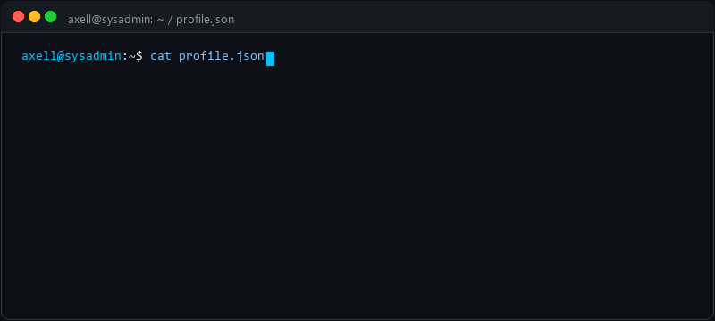

<!--
    Axell Rojas - Systems Administrator & AI Specialist
    GitHub: https://github.com/STXNES
    Portfolio: https://axro-project.vercel.app/
    LinkedIn: https://www.linkedin.com/in/axro
-->

  

### Main skills

### Studying

### Featured Architecture & Labs

 
  
  
  
  
  

Production-grade architectures and enterprise labs spanning hardened Linux servers (CIS Benchmark Level 2, UFW, Nginx TLS 1.3), Windows Server 2022 Active Directory environments (GPOs, AGDLP, VMware), containerized RAG retrieval agents on Oracle Cloud (OCI), and automated n8n workflow systems.  
Explore interactive documentation and demos on my [Web Portfolio](https://axro-project.vercel.app/).

### Connect with me!

  
  &nbsp;
  
  &nbsp;
  
  &nbsp;
  

### Employer?
> [!IMPORTANT]  
> <a href="https://raw.githubusercontent.com/STXNES/STXNES/main/AXELL_ROJAS_CV.pdf" download>Download my resume</a>

  

